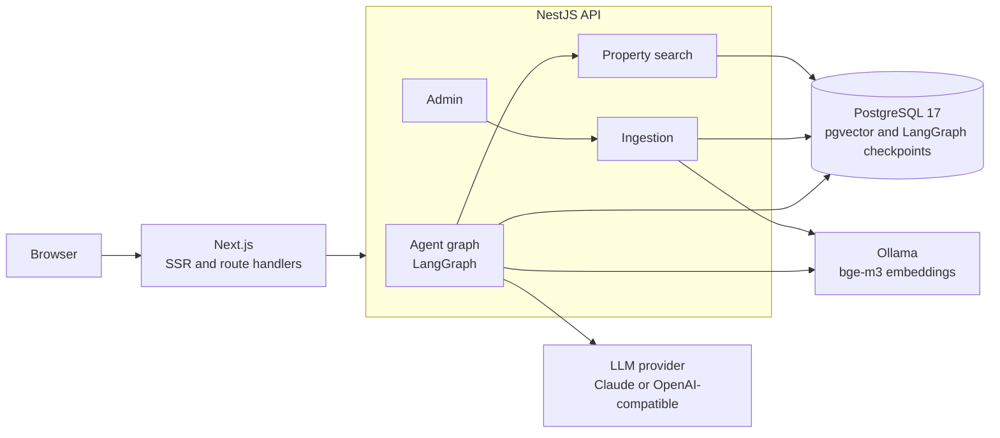
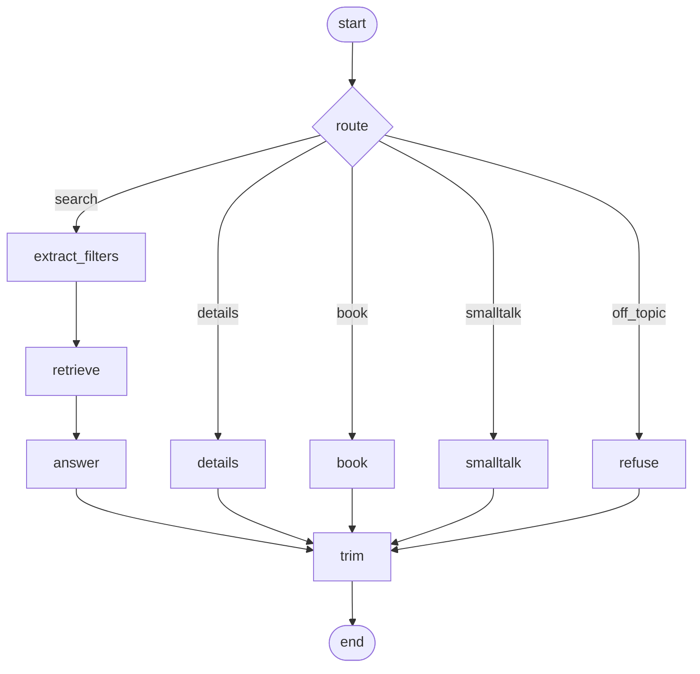

# Real-estate AI agent

An AI assistant for the Egyptian property market, in Arabic and English. A visitor can chat with a LangGraph agent or use a regular filter search, side by side, over the same listings, so the two can be compared directly. An admin uploads listings as markdown files: each file's frontmatter becomes a structured record for the filter search, and its body is chunked and embedded into pgvector for semantic retrieval. The agent answers only from retrieved listings, cites them, and can book a viewing.

<!-- TODO(M4): add a demo GIF and screenshots to docs/media/ and embed them here:
     landing page (chat next to filter search), admin upload, booking flow.
     Do not commit placeholder images. -->

## Features

- **Chat and filter search on one page**, backed by the same data. Chat answers stream over SSE and show property cards built from structured results, not parsed from text.
- **Arabic (including Egyptian dialect) and English**: the agent replies in the visitor's language (Arabic when at least 30 percent of the latest message's letters are Arabic, otherwise English; decided in code, not by the model).
- **Refinements and follow-ups**: "cheaper", "in Zayed instead", "tell me more about the second one".
- **Direct viewing booking** in chat: collects name, Egyptian mobile number and date, validates them, confirms with a reference. No approval step.
- **Admin dashboard** (`/admin`): upload one or many `.md` files, see indexing status and exact validation errors, re-index, delete, list bookings.
- **Idempotent ingestion**: the same content hash is a no-op; a changed file replaces its chunks.
- **Swappable LLM**: Claude or any OpenAI-compatible endpoint (Gemini and Groq free tiers work), chosen by env. The app boots without a key; only chat answers `503`.
- **Eval suite** with a regression gate, runnable locally or from a manual GitHub workflow.

## Architecture



Chat and admin requests go through Next.js: its route handlers and server actions forward them to the API, keep the conversation id in an `HttpOnly` cookie and pass the visitor's IP (signed with a shared key) so rate limits count each visitor.

## Agent graph



| Node | What it does |
| --- | --- |
| `route` | One structured LLM call: intent (`search`, `details`, `book`, `smalltalk`, `off_topic`), qualitative preferences; the reply language is detected from the visitor's message, not asked of the model |
| `extract_filters` | Turns the request into validated filters (zod), one retry on invalid output; refinements start from the previous filters |
| `retrieve` | Filter, then rank by vector similarity (see below); top 5 |
| `answer` | Streams a reply grounded in the retrieved listings, then runs the citation post-check |
| `details` | Resolves "the second one" or a title against the last results and answers from that listing's full text |
| `book` | Collects and validates name, phone, date and an optional time (09:00-21:00, asked once, "any time" accepted); creates the booking only when complete |
| `smalltalk`, `refuse` | Short localized static replies |
| `trim` | Caps the stored history at the last 20 messages |

## How retrieval works

Retrieval is **filter, then rank** ([ADR 0004](docs/adr/0004-filter-then-rank-retrieval.md)). The extracted filters run through the same SQL query as the regular search (visible listings only) and return up to 50 candidates. Only those candidates are ranked, by the cosine similarity of their best chunk to the embedded query (`bge-m3`, 1024 dimensions), and the top 5 go to the model. Every returned listing therefore satisfies the filters: an approximate vector index can never hide a match or return a wrong city. All vector SQL lives in one class, `ChunkRepository`.

## Safety and guardrails

- **Grounding post-check**: the answer may only cite `[slug]` ids of listings retrieved for that turn; any other citation is removed from the text before the visitor sees it.
- **Data, not instructions**: listing text and conversation turns are passed to the model escaped and labelled as data; prompts tell the model never to follow instructions found in them. Off-topic and role-override requests get a static refusal.
- **Budgets**: 1000-character messages, 16 KB request bodies, a 60 s timeout per turn, at most 12 graph steps, a per-IP chat rate limit and a global per-minute chat budget that caps LLM spend.
- **Rollback**: a turn that fails, times out or is stopped leaves the stored conversation exactly as before, so a retry never duplicates a message.
- **PII masking**: phone numbers are masked in the history endpoint (`010****4567`); logs carry only a short hash of the conversation id.
- **Cookie-held conversation ids**: the id is a bearer token for the history, so the browser never sees it (`HttpOnly`, `SameSite=Lax`, `Secure` in production).
- **Validated booking**: Egyptian mobile format, a date after today and inside the booking window, an optional viewing time between 09:00 and 21:00, and one booking per conversation, property and date (booking the same day again at another time updates it). Dates and times are in the business time zone `APP_TIMEZONE` (default `Africa/Cairo`); the booking date is stored as a calendar date, so it never shifts with a browser's time zone.

## Tech stack

| Layer | Technology |
| --- | --- |
| Runtime | Node.js 24, pnpm 12 workspaces |
| API | NestJS 12, Prisma 7.10, zod 4, TypeScript 6 (ESM) |
| Database | PostgreSQL 17 with pgvector (HNSW index) |
| AI | LangChain.js core 1.2, LangGraph.js 1.4, `@langchain/anthropic` 1.5, `@langchain/openai` 1.6 |
| Embeddings | `bge-m3` (1024 dimensions) via local Ollama |
| Web | Next.js 16 (App Router), React 19, Tailwind CSS 4 |
| Quality | Vitest 4, oxlint, GitHub Actions |

## Quick start

Requirements: Node.js 24, pnpm, Docker and [Ollama](https://ollama.com/download).

```bash
pnpm install
cp .env.example .env     # then set ADMIN_TOKEN (see .env.example)
pnpm db:up               # Postgres + pgvector on localhost:5433
pnpm db:migrate
ollama pull bge-m3       # embeddings, runs locally
pnpm seed                # indexes the 20 sample listings (needs Ollama)
```

Add an LLM key so the chat can answer. The free option takes two minutes: create a key at <https://aistudio.google.com/apikey> and put the four lines from [AI chat](#ai-chat) in `.env`. Then:

```bash
pnpm dev                 # api on :3001, web on :3000
```

| URL | What |
| --- | --- |
| <http://localhost:3000> | Landing page: chat and filter search |
| <http://localhost:3000/admin> | Admin dashboard (sign in with `ADMIN_TOKEN`) |
| <http://localhost:3001/api/health> | Health check |

`pnpm seed` starts the API's modules without an HTTP server and runs every file in [`samples/properties`](samples/properties) through the real ingestion service. It prints one row per file and a summary, exits non-zero if any file failed, and is idempotent: a second run reports every file as `unchanged`. If Ollama is not running it stops with "Start Ollama and run `ollama pull bge-m3`".

## AI chat

The chat needs an LLM. The app boots without one (the filter search and admin keep working) and `POST /api/chat` answers `503 The AI assistant is not configured`. Embeddings still come from local Ollama (`bge-m3`).

### Free option: Google Gemini

1. Create a key at <https://aistudio.google.com/apikey>.
2. Put these four lines in `.env` (the key never leaves your machine; `.env` is git-ignored):

```bash
LLM_PROVIDER=openai-compatible
OPENAI_COMPAT_BASE_URL=https://generativelanguage.googleapis.com/v1beta/openai/
OPENAI_COMPAT_API_KEY=<your key>
OPENAI_COMPAT_MODEL=gemini-3.8-flash
```

3. Restart `pnpm dev`. The web app needs `INTERNAL_API_KEY` set to the same value as the API and `TRUSTED_PROXY_HOPS` set to your proxy count (see `.env.example` and Deployment notes) so chat rate limits count each visitor, not the web server.

Fallback if Gemini is rate limited: Groq. Same four lines with `OPENAI_COMPAT_BASE_URL=https://api.groq.com/openai/v1`, a key from <https://console.groq.com/keys> and a Groq model name.

For Claude set `LLM_PROVIDER=claude` and `ANTHROPIC_API_KEY`. If a provider rejects tool calling for structured output, try `LLM_STRUCTURED_METHOD=jsonSchema`.

### Tracing

LangSmith tracing needs no code: set `LANGSMITH_TRACING=true`, `LANGSMITH_API_KEY` and optionally `LANGSMITH_PROJECT` in the API environment.

### Limits

`POST /api/chat` is limited to `CHAT_THROTTLE_LIMIT` (default 10) requests per `THROTTLE_TTL_SECONDS` per client IP, to `CHAT_GLOBAL_LIMIT_PER_MINUTE` (default 30) requests per minute across all visitors, messages to 1000 characters, request bodies to 16 KB and each turn to 60 seconds. Over a limit the API answers `429` with a friendly JSON message and a `Retry-After` header (seconds), which the web route passes through.

A turn that fails, times out or is stopped by the visitor is rolled back: the stored conversation looks as if the message had never been sent, so a retry never duplicates it. Stored history is capped at the last 20 messages per conversation.

## Admin usage

Open <http://localhost:3000/admin>, sign in with `ADMIN_TOKEN`, and upload one or more `.md` files (up to 10 per request, 200 KB each). Each document shows `PENDING`, `INDEXED` or `FAILED`; a failed one shows the exact validation error, and every document can be re-indexed or deleted. Bookings made in chat are listed on the same dashboard.

The same endpoint works from a script, authenticated with the `x-admin-token` header:

```bash
curl -H "x-admin-token: $ADMIN_TOKEN" \
  -F "files=@samples/properties/zamalek-apartment-rent.md" \
  http://localhost:3001/api/admin/documents
```

### Listing file format

YAML frontmatter for the structured fields, markdown for the description. The body can be Arabic or English; headings give the chunker natural boundaries.

```markdown
---
slug: zamalek-apartment-rent       # unique, lowercase kebab-case
title: Furnished two-bedroom apartment for rent in Zamalek
type: apartment                    # apartment | villa | townhouse | duplex | chalet | studio | office
listing: RENT                      # SALE | RENT (for RENT, price is per month)
price: 55000
currency: EGP                      # optional, default EGP
bedrooms: 2
bathrooms: 2
areaM2: 140
city: Zamalek
district: 26th of July Street      # optional
compound: Palm Crest               # optional
deliveryDate: 2027-03-31           # optional
finishing: fully furnished         # optional
paymentPlan: Monthly rent, two months deposit   # optional
---

## Location

Quiet side street just off 26th of July Street, a ten-minute walk to the Opera House.

## The unit

A 140 m² apartment on the third floor with two bedrooms, a bright reception and a balcony.
```

Unknown keys are rejected, so a typo surfaces as an error instead of silently missing data. See [`samples/properties`](samples/properties) for complete examples.

## Testing

```bash
pnpm test        # api (Vitest) and web (node:test)
```

- **API: 431 tests in Vitest.** 345 are unit tests (graph transitions with a fake model and an in-memory checkpointer, citations, booking validation, listing references, schemas, eval scoring). 86 are integration tests against a real Postgres: ingestion, admin, search, retrieval, SSE chat and booking. They use a separate `realestate_test` database that is created and migrated automatically; without Postgres they are skipped locally and fail in CI.
- **Web: 20 tests** with the Node test runner.
- No test calls a real LLM; the model sits behind an `AgentModel` port that tests replace with a fake. Quality against a real model is measured by the evals below.

`pnpm lint`, `pnpm typecheck` and `pnpm build` cover both apps; CI runs all four on every push and pull request.

## Evals

Unit tests prove the plumbing; the eval suite measures the agent itself. `pnpm eval` runs 13 cases over the 20 sample listings through the **real** compiled graph, the real model and real `bge-m3` embeddings: 6 English, 4 Arabic (Egyptian dialect) and 3 multi-turn follow-ups ("cheaper", "tell me more about the second one", "tell me more about the townhouse"). One English case is an off-topic request that tries to override the assistant, and one asks to book a viewing and stops before any personal data is given.

```bash
pnpm seed                        # listings must be indexed first
pnpm eval                        # run all cases
pnpm eval --only=en-booking-intent,ar-duplex-zayed-garden   # subset: never gated
pnpm eval --update-baseline      # record the current metrics as the baseline
pnpm eval --allow-model-mismatch # compare against a baseline from another model
```

Each case lists the conversation and what the **last** reply must satisfy (`api/evals/cases.json`). Only what the last turn's intent produced is scored; state left over from earlier turns is ignored. For a `search` turn that is the intent, a subset of filters that must match, at least one expected listing in the top 5, and listings that must not appear. For a `details` turn it is the listing the reference ("the second one", "the townhouse") resolved to (`focusSlug`, one slug or several when the earlier ranking is not deterministic). Every case also states whether the reply must be a refusal. Cases run one after another, each on a fresh in-memory conversation, so the dev database's conversations are never touched; bookings are disabled outright, so a case cannot create one.

| Metric | Definition |
| --- | --- |
| Intent accuracy | Routed intent equals the expected one |
| Filter accuracy | Field-level exact match over the expected filter fields (text is case-insensitive) |
| Retrieval hit@5 | At least one expected listing is in the top 5 |
| Exclusion | None of the forbidden listings is in the top 5 |
| Reference accuracy | A `details` turn resolved to an expected listing |
| Groundedness | Every `[slug]` the model cited, before the post-check, was among the listings the production answer may cite: the turn's retrieved listings for a search, only the detail card for a details turn |
| Refusal correctness | The reply is the standard refusal exactly when the case expects one |
| Avg conversation latency, total tokens | Summed over **all** turns of a case, not just the last one. Reported, not gated (they depend on provider and load) |

The run prints a table per case and a totals table, and writes `api/evals/results/latest.json` (git-ignored).

**Baseline gate.** `api/evals/baseline.json` holds the committed metrics together with the provider and model that produced them. Rules for a full run:

- A quality metric that falls more than `EVAL_TOLERANCE` (default `0.05`) below the baseline fails the run (exit 1). So does a metric that is a number in the baseline but could not be measured now.
- If the baseline's provider or model differs from the current run, the gate refuses to compare and exits 1 with a message, because the numbers are not comparable. Re-record the baseline, or pass `--allow-model-mismatch` to compare anyway (a warning is printed).
- With no `baseline.json`, a local run prints `No baseline yet` and exits 0; when `CI` is set it exits 1.
- `--only=...` runs are **never gated** (`Subset run: regression gate skipped`): a few cases cannot be compared with a full baseline.
- `--update-baseline` runs all cases and records the result; it refuses to do so when a case crashed and cannot be combined with `--only`.

| Variable | Default | Purpose |
| --- | --- | --- |
| `EVAL_DELAY_MS` | `4000` | Minimum pause between two LLM calls, for free-tier rate limits |
| `EVAL_TOLERANCE` | `0.05` | Allowed drop below the baseline |
| `EVAL_RETRY_WAIT_MS` | `20000` | Wait before the single retry of a case that got a 429 |

Without an LLM configured, `pnpm eval` prints `Eval skipped: no LLM configured (see README)` and exits 0; when `CI` is set it exits 1 instead, so a pipeline cannot pass by skipping. This check looks only at the LLM variables and runs before the rest of the environment is validated, so it works even without a complete `.env`. The tuning variables are documented in `.env.example`.

**CI.** The [Eval workflow](.github/workflows/eval.yml) runs only on manual trigger (`workflow_dispatch`) because every run spends LLM quota. It starts pgvector, migrates, installs a pinned Ollama release (checksum-verified; bump `OLLAMA_VERSION` and `OLLAMA_SHA256` together) and `bge-m3`, runs `pnpm seed` and `pnpm eval`, and uploads `latest.json` as an artifact. The LLM secrets and variables are set only on the "Run the eval" step, so the install and download steps never see them. Configure them under Settings, Secrets and variables, Actions:

| Kind | Name | Required | Notes |
| --- | --- | --- | --- |
| Secret | `OPENAI_COMPAT_API_KEY` | For Gemini, Groq or any OpenAI-compatible provider | |
| Secret | `ANTHROPIC_API_KEY` | For Claude | Also set variable `LLM_PROVIDER=claude` |
| Variable | `LLM_PROVIDER` | No | Default `openai-compatible` |
| Variable | `OPENAI_COMPAT_BASE_URL`, `OPENAI_COMPAT_MODEL` | No | Default: Gemini (`gemini-3.8-flash`) |
| Variable | `CLAUDE_MODEL`, `LLM_STRUCTURED_METHOD` | No | |
| Variable | `EVAL_DELAY_MS`, `EVAL_TOLERANCE`, `EVAL_RETRY_WAIT_MS` | No | |

**Recording the baseline in CI.** The runner cannot commit, so run the workflow with the `update_baseline` input ticked. It runs `pnpm eval --update-baseline` and uploads `api/evals/baseline.json` as the `eval-baseline` artifact. Download it and commit it as `api/evals/baseline.json`. Until a baseline is committed, every normal (gated) run in CI fails with `No baseline yet`.

> Status: the eval suite and gate are implemented and unit-tested; the first real run, and so `baseline.json`, is pending an LLM key.

## Deployment notes

- **Client IP and `TRUSTED_PROXY_HOPS`.** Per-visitor rate limiting needs the visitor's IP at the API. The Next.js server reads it from `x-forwarded-for` and forwards it, signed with `INTERNAL_API_KEY`, in `x-client-ip`. A visitor controls the beginning of `x-forwarded-for` (they can send any value) and every proxy appends the address it saw on the right, so only the right-hand entries added by your own proxies can be trusted. Next.js leaves a present `x-forwarded-for` untouched and does not append the connecting address (checked on Next 16.4, `next dev` and `next start`). With `TRUSTED_PROXY_HOPS=N` (the number of reverse proxies you run in front of Next, default `0`) the visitor is the entry `N` from the right: `nginx -> next` is `1`, `cdn -> nginx -> next` is `2`. With `0` nothing is trusted: no IP is forwarded and all visitors share one per-IP budget (safe, but coarse). Make your outermost proxy append the connecting address (nginx: `proxy_set_header X-Forwarded-For $proxy_add_x_forwarded_for;`) and do not expose Next.js directly to the internet when `TRUSTED_PROXY_HOPS` is above `0`. `x-real-ip` is never used.
- **Global chat budget.** `CHAT_GLOBAL_LIMIT_PER_MINUTE` counts every chat request regardless of IP, so it bounds LLM spend even if the per-IP limit is bypassed or one NAT hides many visitors. Size it to your provider quota. Throttle counters are kept in memory.
- **Single API instance.** The "one reply at a time per conversation" lock and the throttle counters live in the API process. Run one API instance, or move both to shared storage (for example Redis) before scaling out; with several instances a visitor could run two turns of the same conversation at once.
- **Conversation cookie.** The conversation id is a bearer token for the stored history, so the browser never sees it: the Next route keeps it in the `chat_thread` cookie (`HttpOnly`, `SameSite=Lax`, `Secure` in production, path `/api/chat`, 30 days). A missing or invalid cookie starts a new conversation, and "New chat" (`POST /api/chat/reset`) rotates it. Serve production over HTTPS so the `Secure` cookie is stored. The API logs only a short hash of the id, and the history endpoint masks phone numbers (`010****4567`).

## Commands

| Command | Purpose |
| --- | --- |
| `pnpm dev` | Run api and web in watch mode |
| `pnpm db:up` / `pnpm db:down` | Start / stop the database container |
| `pnpm db:migrate` | Apply Prisma migrations |
| `pnpm seed` | Index the sample listings through the real ingestion service |
| `pnpm eval` | Run the eval suite (needs an LLM; see Evals) |
| `pnpm lint` / `pnpm typecheck` / `pnpm test` / `pnpm build` | Quality gates for both apps |

To create a new migration run `pnpm --filter api db:migrate:create`. Prisma cannot model the HNSW index on `Chunk.embedding`, so it proposes dropping it: remove that `DROP INDEX` statement from the generated SQL.

## Project structure

```text
.
├── api/                    NestJS API
│   ├── src/                agent, admin, ingestion, properties, bookings, llm, config
│   ├── prisma/             schema and migrations
│   ├── scripts/            seed command
│   └── evals/              eval cases, runner, scoring, baseline
├── web/                    Next.js app
│   └── src/                app routes, components, lib
├── samples/properties/     20 synthetic listings (.md)
├── docs/                   PLAN.md, adr/, agents/, media/ (screenshots, planned)
├── .github/workflows/      ci.yml, eval.yml (manual)
└── docker-compose.yml      Postgres 17 + pgvector
```

## Architecture decisions

| ADR | Decision |
| --- | --- |
| [0001](docs/adr/0001-frontmatter-feeds-both-searches.md) | Frontmatter feeds both searches |
| [0002](docs/adr/0002-own-chunk-table-over-langchain-pgvectorstore.md) | Own chunk table over LangChain PGVectorStore |
| [0003](docs/adr/0003-langgraph-for-agent-flow.md) | LangGraph for the agent flow |
| [0004](docs/adr/0004-filter-then-rank-retrieval.md) | Filter then rank retrieval |

More: [docs/PLAN.md](docs/PLAN.md) for scope and milestones, [AGENTS.md](AGENTS.md) for contributor and coding-agent conventions.

## Sample data

The listings in [`samples/properties`](samples/properties) are **synthetic**. Compounds, developers, prices and contact details are invented for demonstration and do not describe real properties. For rentals, `price` is the monthly rent.

## License

[MIT](LICENSE) © 2026 Mohamed Medhat Kamal
