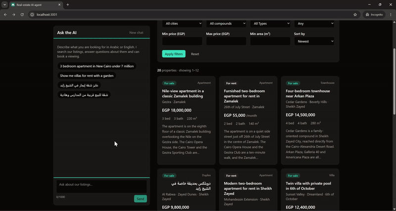
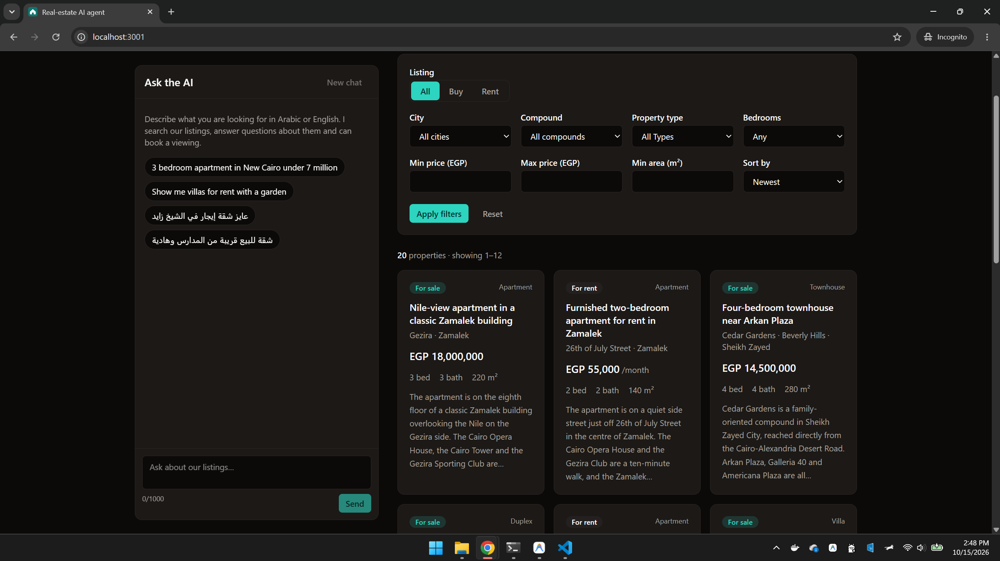
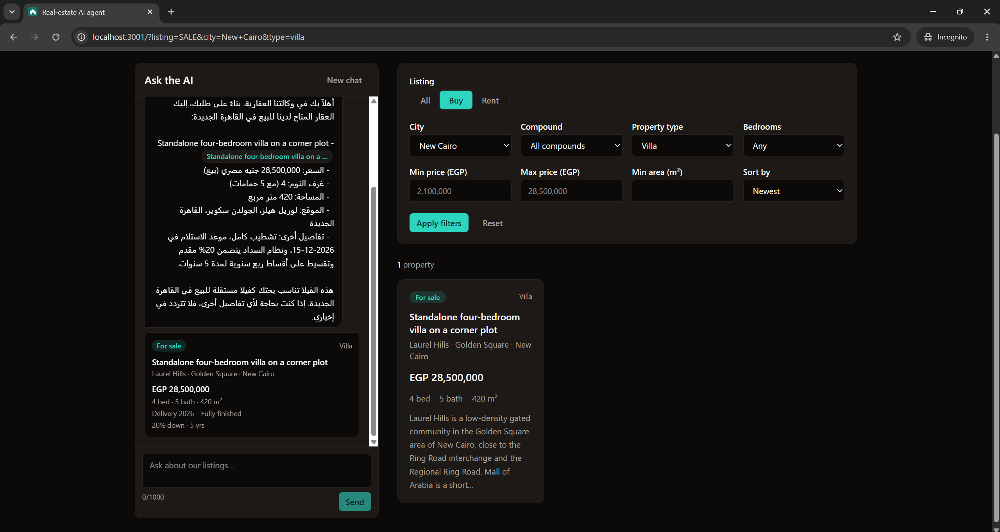
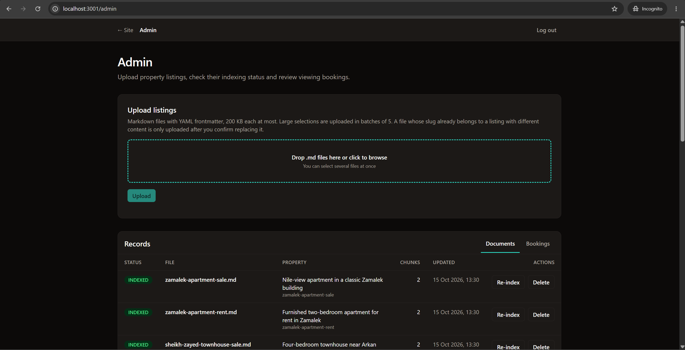
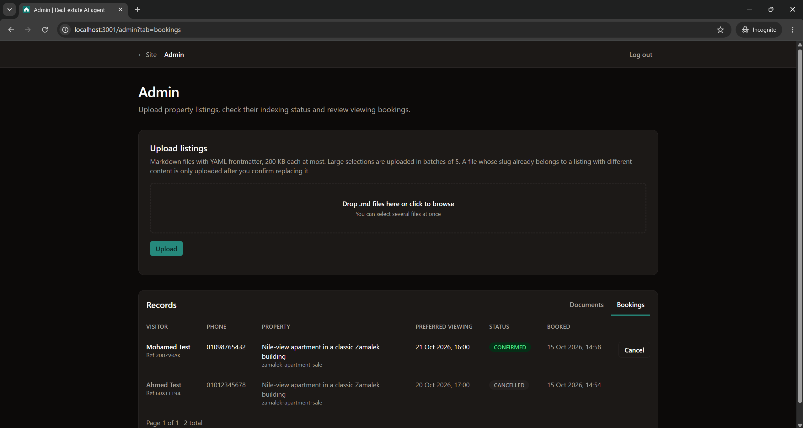
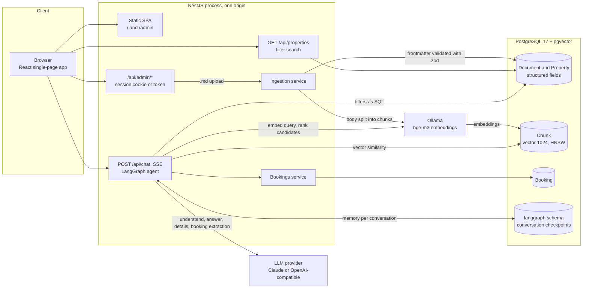
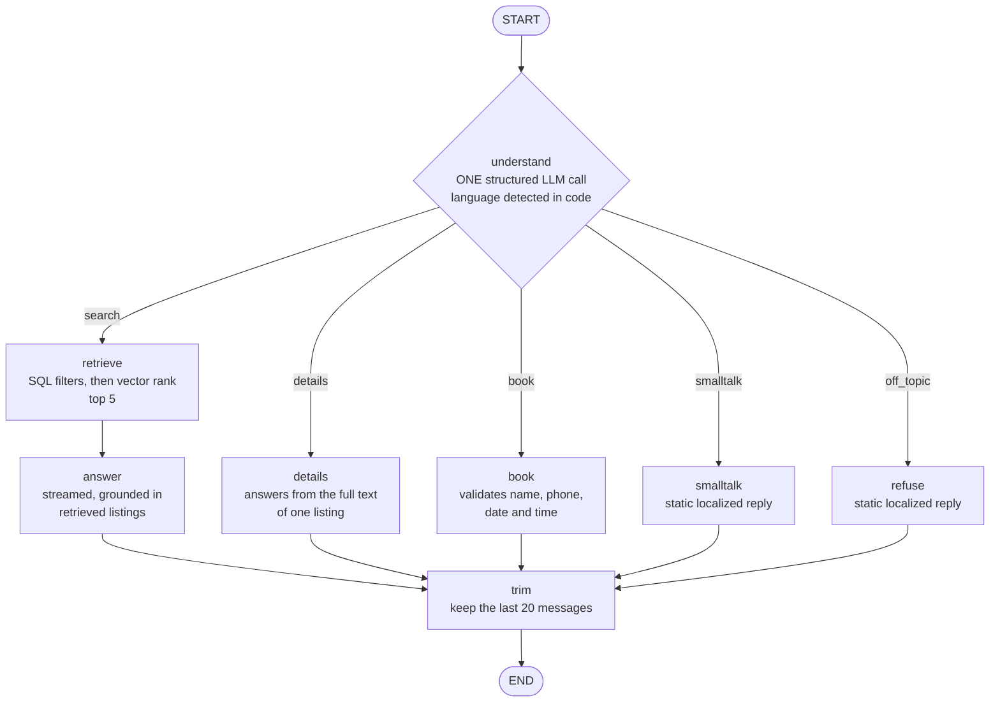

# Real-estate AI agent

An AI assistant for the Egyptian property market, in Arabic and English. A visitor can chat with a LangGraph agent or use a regular filter search, side by side, over the same listings, so the two can be compared directly. The agent answers only from retrieved listings, cites them, and can book a viewing.

An admin uploads listings as markdown files: each file's frontmatter becomes a structured record for the filter search, and its body is chunked and embedded into pgvector for semantic retrieval.

## Demo

Screenshots and a short demo GIF are coming.

<!--
Media added by the owner (see docs/media/README.md for what each file shows):






-->

## Features

- **Chat and filter search on one page**, backed by the same data. Chat answers stream over SSE and show property cards built from structured results, not parsed from text.
- **Arabic (including Egyptian dialect) and English**: the agent replies in the visitor's language (Arabic when at least 30 percent of the latest message's letters are Arabic, otherwise English; decided in code, not by the model).
- **Refinements and follow-ups**: "cheaper", "in Zayed instead", "tell me more about the second one".
- **Direct viewing booking** in chat: collects name, Egyptian mobile number and date, validates them, confirms with a reference. No approval step.
- **Admin dashboard** (`/admin`): upload one or many `.md` files, see indexing status and exact validation errors, re-index, delete, list and cancel bookings.
- **Idempotent, safe ingestion**: the same content hash is a no-op. A file whose slug already belongs to a listing with different content is only written after the admin confirms replacing it; then its chunks are replaced.
- **Swappable LLM**: Claude or any OpenAI-compatible endpoint (Gemini and Groq free tiers work), chosen by env. The app boots without a key; only chat answers `503`.
- **Eval suite** with a regression gate, runnable locally or from a manual GitHub workflow.

| Layer | Technology |
| --- | --- |
| Runtime | Node.js 24, pnpm 12 workspaces |
| API | NestJS 12, Prisma 7.10, zod 4, TypeScript 6 (ESM) |
| Database | PostgreSQL 17 with pgvector (HNSW index) |
| AI | LangChain.js core 1.2, LangGraph.js 1.4, `@langchain/anthropic` 1.5, `@langchain/openai` 1.6 |
| Embeddings | `bge-m3` (1024 dimensions) via local Ollama |
| Web | Vite 8, React 19, React Router, TanStack Query, Tailwind CSS 4 |
| Quality | Vitest, oxlint (api), ESLint (web), GitHub Actions |

## Architecture

One NestJS process serves the built web app (a Vite and React single-page app) and the API from the same origin ([ADR 0005](docs/adr/0005-vite-spa-served-by-nest-over-nextjs.md)). Postgres holds the listings, their embedded chunks, the bookings and the LangGraph conversation checkpoints (own `langgraph` schema). Embeddings come from a local Ollama; chat completions from any configured LLM provider.



### Agent graph

The agent is a LangGraph `StateGraph` built in `apps/api/src/agent/agent-graph.ts`. One structured LLM call classifies the turn; a conditional edge routes it; every path ends in `trim`.



Deterministic guards sit around the model, in code rather than in prompts:

- **`understand`**: the new-search guard (`new-search-guard.ts`) drops filters and preferences a new search copied from the previous one unless the visitor restated them; a changed sale/rent or property type forces a new search; "the second one" / "التاني" is resolved from the visitor's own words against the list shown last (`listing-reference.ts`), with the model's reference only as a fallback; the reply language comes from the message's letters.
- **`retrieve`**: the filters are plain SQL (the same query as the regular search), and the vector similarity only orders the survivors ([ADR 0004](docs/adr/0004-filter-then-rank-retrieval.md)).
- **`answer` and `details`**: a citation post-check removes any `[slug]` that was not among the listings allowed for that turn (`citations.ts`, `grounding.ts`).

| Node | What it does |
| --- | --- |
| `understand` | ONE structured LLM call ([ADR 0006](docs/adr/0006-one-llm-call-to-understand-a-turn.md)): the intent (`search`, `details`, `book`, `smalltalk`, `off_topic`), the listing referred to, and for a search the mode (new or refine), the qualitative preferences and the filters. The output is validated with zod (one retry); a change of sale/rent or property type forces a new search; refinements start from the previous filters. The reply language is detected from the visitor's message, not asked of the model |
| `retrieve` | Filter, then rank by vector similarity (see [How it works](#how-it-works)); top 5 |
| `answer` | Streams a reply grounded in the retrieved listings, then runs the citation post-check |
| `details` | Resolves the listing (position, slug or title) against the last results and answers from its full text |
| `book` | Collects and validates name, phone, date and an optional time (09:00-21:00, asked once, "any time" accepted); creates the booking only when complete |
| `smalltalk`, `refuse` | Short localized static replies |
| `trim` | Caps the stored history at the last 20 messages |

LLM calls per turn: a search (new or refined) makes two (`understand`, `answer`), a details turn two (`understand`, the answer), a booking turn two (`understand`, the booking extraction), smalltalk and refusals one. The only extra call is the rare identity safety net, which re-asks `understand` once as a new search.

## How it works

### Ingestion

The admin uploads `.md` files (YAML frontmatter plus a markdown body; see [Listing file format](#listing-file-format)).

1. The frontmatter is parsed (`gray-matter`) and validated with zod. Unknown keys are rejected; an invalid file is marked `FAILED` and the exact error is shown.
2. A valid file is upserted as a `Property` (the structured fields the filter search queries). Its identity is the `slug`: identical content is `unchanged`, different content under an existing slug is a `conflict` until the admin approves the replacement ([Admin login](#admin-login)).
3. The body is split with LangChain's `MarkdownTextSplitter` (800 characters, 100 overlap). Each chunk is prefixed with a one-line header (title, type, sale or rent, place) so a chunk keeps its context, embedded with `bge-m3` and stored in pgvector. A chunk table of our own, not a LangChain vector store ([ADR 0002](docs/adr/0002-own-chunk-table-over-langchain-pgvectorstore.md)).

Only `INDEXED` documents are visible to the search and the agent. The frontmatter feeds both the filter search and the agent's filters ([ADR 0001](docs/adr/0001-frontmatter-feeds-both-searches.md)).

### A chat turn

1. `POST /api/chat` streams Server-Sent Events. The conversation id lives in an `HttpOnly` cookie, never in a URL or body.
2. `understand` makes one structured LLM call and the deterministic guards above adjust its result.
3. A search goes through `retrieve`: the extracted filters run through the same SQL query as the regular search (visible listings only) and return up to 50 candidates. Only those candidates are ranked, by the cosine similarity of their best chunk to the embedded query (`bge-m3`, 1024 dimensions), and the top 5 go to the model. Every returned listing therefore satisfies the filters: an approximate vector index can never hide a match or return a wrong city. All vector SQL lives in one class, `ChunkRepository`.
4. `answer` streams a reply from those listings; the cards are sent as structured events, not parsed from the text.
5. `trim` caps the history, and the checkpoint is stored in Postgres. A turn that fails, times out or is stopped leaves the stored conversation exactly as before, so a retry never duplicates a message.

### Booking

The `book` node collects name, Egyptian mobile number, date and an optional viewing time across turns, validating each in code: Egyptian mobile format, a date after today and inside the booking window, a time between 09:00 and 21:00, and one booking per conversation, property and date (booking the same day again at another time updates it). Dates and times are in the business time zone `APP_TIMEZONE` (default `Africa/Cairo`); the booking date is stored as a calendar date, so it never shifts with a browser's time zone. The booking is `CONFIRMED` immediately and the visitor gets a reference. The admin can cancel it; a cancelled booking keeps its row, so the chat never re-books that slot.

## Key design decisions

| ADR | Decision |
| --- | --- |
| [0001](docs/adr/0001-frontmatter-feeds-both-searches.md) | Frontmatter feeds both searches: one structured record serves the filter search and the agent's filters |
| [0002](docs/adr/0002-own-chunk-table-over-langchain-pgvectorstore.md) | Own chunk table over LangChain PGVectorStore, so all vector SQL stays in one repository |
| [0003](docs/adr/0003-langgraph-for-agent-flow.md) | LangGraph for the agent flow: explicit nodes, edges and checkpointed state |
| [0004](docs/adr/0004-filter-then-rank-retrieval.md) | Filter then rank retrieval: SQL filters pick the candidates, vectors only order them |
| [0005](docs/adr/0005-vite-spa-served-by-nest-over-nextjs.md) | Vite SPA served by NestJS, replacing Next.js: one origin, no backend-for-frontend |
| [0006](docs/adr/0006-one-llm-call-to-understand-a-turn.md) | One LLM call to understand a turn (route and filter extraction merged), fail-fast LLM calls |

More: [docs/PLAN.md](docs/PLAN.md) for scope and milestones, [AGENTS.md](AGENTS.md) for contributor and coding-agent conventions.

## Getting started

### Prerequisites

- **Node.js 24** and **pnpm 12** (the repo pins `pnpm@12.11.2` in `package.json`).
- **Docker**, for PostgreSQL 17 with pgvector.
- **[Ollama](https://ollama.com/download)** with the embedding model: `ollama pull bge-m3`.
- **An LLM key** for the chat: the Gemini free tier through its OpenAI-compatible endpoint (key at <https://aistudio.google.com/apikey>, setup in [AI chat](#ai-chat)) or an Anthropic key (`ANTHROPIC_API_KEY`). The app boots without one; the filter search and admin work, and only the chat answers `503`.

Every setting is documented in [`.env.example`](.env.example).

### Run it

```bash
cp .env.example .env     # then set ADMIN_TOKEN (see "Admin login") and your LLM key
pnpm db:up               # Postgres + pgvector on host port 5433
pnpm install
pnpm db:migrate          # create the tables
pnpm seed                # index the 20 listings in samples/properties (needs Ollama running)
```

Then pick one:

| Mode | Command | Where |
| --- | --- | --- |
| Development (hot reload) | `pnpm dev` | The app at <http://localhost:3000> (Vite). It proxies `/api` to the API on <http://localhost:3001> (`PORT` in `.env`). |
| One process, one port | `pnpm build && pnpm start` | NestJS serves the built web app and the API from <http://localhost:3001> (`PORT` in `.env`). |

Either way the landing page is `/` (chat and filter search), the admin dashboard is `/admin`, and <http://localhost:3001/api/health> is the health check.

`pnpm seed` runs every file in [`samples/properties`](samples/properties) through the real ingestion service. It prints one row per file and a summary, exits non-zero if any file failed, and is idempotent: a second run reports every file as `unchanged`. If Ollama is not running it stops with "Start Ollama and run `ollama pull bge-m3`".

### Commands

| Command | Purpose |
| --- | --- |
| `pnpm dev` | Run the API and the web dev server together (hot reload) |
| `pnpm build` | Build the web app, then the API |
| `pnpm start` | Run the built API, which also serves the built web app |
| `pnpm db:up` / `pnpm db:down` | Start / stop the database container |
| `pnpm db:migrate` | Apply Prisma migrations |
| `pnpm seed` | Index the sample listings through the real ingestion service |
| `pnpm eval` | Run the eval suite (needs an LLM; see [Evals](#evals)) |
| `pnpm lint` / `pnpm typecheck` / `pnpm test` | Quality gates for both apps |

To create a new migration run `pnpm db:migrate:create`. Prisma cannot model the HNSW index on `Chunk.embedding`, so it proposes dropping it: remove that `DROP INDEX` statement from the generated SQL.

### AI chat

The chat needs an LLM. The app boots without one (the filter search and admin keep working) and `POST /api/chat` answers `503 The AI assistant is not configured`. Embeddings still come from local Ollama (`bge-m3`).

#### Free option: Google Gemini

1. Create a key at <https://aistudio.google.com/apikey>.
2. Put these four lines in `.env` (the key never leaves your machine; `.env` is git-ignored):

```bash
LLM_PROVIDER=openai-compatible
OPENAI_COMPAT_BASE_URL=https://generativelanguage.googleapis.com/v1beta/openai/
OPENAI_COMPAT_API_KEY=<your key>
OPENAI_COMPAT_MODEL=gemini-3.5-flash-lite
```

3. Restart `pnpm dev` (or `pnpm start`). Behind a reverse proxy also set `TRUSTED_PROXY_HOPS` to your proxy count (see `.env.example` and [Deployment notes](#deployment-notes)) so chat rate limits count each visitor.

`gemini-3.5-flash-lite` is the default: it recorded the committed eval baseline and had enough free-tier headroom for two full eval runs plus a browser pass (over 100 calls in one day). The free tier caps requests per day for each model (20 per day for `gemini-3.5-flash` when this was tested; the larger `3.7`/`3.8` flash models hung or returned 503 under load), so to switch model change `OPENAI_COMPAT_MODEL` and restart; the eval gate refuses a model other than the baseline's until you re-record it. Free-tier latency varies from about 1 to 10 seconds per model call, and a search turn (several calls) can take 30 to 50 seconds, so one chat turn is allowed `CHAT_TURN_TIMEOUT_MS` (default `90000`) before it is rolled back.

Fallback if Gemini is rate limited: Groq. Same lines with `OPENAI_COMPAT_BASE_URL=https://api.groq.com/openai/v1`, `OPENAI_COMPAT_MODEL=openai/gpt-oss-120b` and a free key from <https://console.groq.com/keys> (no card; the free tier is about 8k tokens per minute per model). The same lines are in `.env.example`.

**Fail fast.** LangChain retries a failed call silently with backoff, which used to stretch a slow turn until it hit `CHAT_TURN_TIMEOUT_MS`. Now `LLM_MAX_RETRIES` (default `1`) caps the retries and `LLM_CALL_TIMEOUT_MS` (default `30000`) bounds each LLM call (the whole call for structured output, the wait for the first token for a streamed answer). When the provider answers 429, 503 or "overloaded", or one call times out, the turn ends at once with a friendly error event (code `provider_busy`: "The AI provider is busy right now. Please try again in a minute.", in Arabic for an Arabic conversation) and is rolled back like any failed turn; the chat shows it with a Try again button. A permanent failure (exhausted quota or billing, a per-day quota, a missing or rejected API key) is not "busy": the turn ends with code `provider_unavailable` ("The AI assistant is not available right now.") and is logged with `reason` `provider_quota_or_auth`. `chat_turn_failed` is logged with `reason` `provider_busy`, `provider_quota_or_auth`, `timeout` (the whole turn exceeded `CHAT_TURN_TIMEOUT_MS`) or `error`.

For Claude set `LLM_PROVIDER=claude` and `ANTHROPIC_API_KEY`. If a provider rejects tool calling for structured output, try `LLM_STRUCTURED_METHOD=jsonSchema`.

#### Tracing

LangSmith tracing needs no code: set `LANGSMITH_TRACING=true`, `LANGSMITH_API_KEY` and optionally `LANGSMITH_PROJECT` in the API environment.

#### Limits

`POST /api/chat` is limited to `CHAT_THROTTLE_LIMIT` (default 10) requests per `THROTTLE_TTL_SECONDS` per client IP, to `CHAT_GLOBAL_LIMIT_PER_MINUTE` (default 30) requests per minute across all visitors, messages to 1000 characters, request bodies to 16 KB, at most 12 graph steps per turn, and each turn to `CHAT_TURN_TIMEOUT_MS` (default 90 seconds). Over a limit the API answers `429` with a friendly JSON message and a `Retry-After` header (seconds), which the web app turns into a message such as "wait 17 seconds".

A turn that fails, times out or is stopped by the visitor is rolled back: the stored conversation looks as if the message had never been sent, so a retry never duplicates it. Stored history is capped at the last 20 messages per conversation.

## Admin login

There are no user accounts. Visitors use the landing page (chat and filter search) without logging in.

The only login is the **admin dashboard at `/admin`**. Its password is the `ADMIN_TOKEN` value from `.env`: one shared secret, no username. Pick a long random string (at least 32 characters; the API refuses to start with a shorter one), for example:

```bash
openssl rand -hex 32
# or, without openssl:
node -e "console.log(require('crypto').randomBytes(32).toString('hex'))"
```

Put the output after `ADMIN_TOKEN=` in `.env` and restart the API. Never commit `.env`.

Open `/admin`, paste the token and press **Log in**. What an admin can do:

- **Upload** `.md` listings (YAML frontmatter plus a markdown body; the format is in [Listing file format](#listing-file-format) and complete examples are in [`samples/properties`](samples/properties)). The dashboard accepts up to 200 KB per file and sends them 5 per request; the API accepts up to 10.
- **Re-index** a document, or **delete** it. Each document shows `PENDING`, `INDEXED` or `FAILED`; a failed one shows the exact validation error.
- **View bookings** made in the chat, and **cancel** one (a confirmation dialog shows its reference, property, date, time and name first). A cancelled booking stays in the list, muted, and its slot is not re-booked by the chat.

**Deleting a listing** is blocked only by its _active_ bookings: the dashboard (and the API, `409`) says "Cannot delete <file>: its property has N active booking(s). Cancel them in Bookings first." Once only cancelled bookings remain, deleting the listing also deletes them, in the same transaction.

A listing's identity is the `slug` in its frontmatter. Uploading a file whose slug already exists is safe: if the content is identical it is skipped (`unchanged`), and if it differs the API writes nothing and the dashboard asks, per file, whether to replace the existing listing (Replace, Skip, Replace all, Skip all). Only approved files are uploaded again, and an approval names the exact stored version you saw: if the listing changed in the meantime, the file comes back as a conflict again and nothing is overwritten. Replacing keeps the listing's bookings.

**Log out** (top right) ends the session. The session is an `HttpOnly` cookie set by the API after a successful login (`SameSite=Strict`, scoped to `/api/admin`, `Secure` in production): the page's scripts cannot read it, it never contains the token itself (it is signed with a key derived from it), and it expires after 8 hours. Changing `ADMIN_TOKEN` or restarting the API signs everyone out, because the signing key is derived at startup. Logging out clears the cookie in the browser but cannot revoke a copy of it: a copied cookie stays valid until it expires (8 hours) or the API restarts. Login attempts are limited to 5 per minute per IP, and so are wrong `x-admin-token` values on any admin endpoint (the 6th answers `429` with `Retry-After`).

### Admin API

The same endpoints work from a script, authenticated with the `x-admin-token` header. State-changing requests must also carry `X-Requested-With: fetch` (the CSRF guard). The upload answer has one result per file: `created`, `updated`, `unchanged`, `failed` or `conflict`. A `conflict` (the slug belongs to a listing with different content) writes nothing and describes the listing it would overwrite; repeat the upload with one `replacements` field per listing you approve. Each is a JSON object with the `slug` and the `existingContentHash` that the conflict reported (at most 10); if the stored listing no longer has that hash, you get a conflict again with the fresh details:

```bash
curl -H "x-admin-token: $ADMIN_TOKEN" -H "X-Requested-With: fetch" \
  -F "files=@samples/properties/zamalek-apartment-rent.md" \
  http://localhost:3001/api/admin/documents

# after a conflict, replace the listing that owns the slug
curl -H "x-admin-token: $ADMIN_TOKEN" -H "X-Requested-With: fetch" \
  -F "files=@samples/properties/zamalek-apartment-rent.md" \
  -F 'replacements={"slug":"zamalek-apartment-rent","existingContentHash":"<hash from the conflict>"}' \
  http://localhost:3001/api/admin/documents
```

Admin endpoints (all under `/api/admin`, all need the admin session cookie or `x-admin-token`; the state-changing ones also `X-Requested-With: fetch`):

| Method and path | Purpose |
| --- | --- |
| `GET /documents?page&pageSize` | List documents with status and chunk count |
| `POST /documents` | Upload `.md` files (multipart `files`, optional `replacements`) |
| `POST /documents/:id/reindex` | Re-index one document |
| `DELETE /documents/:id` | Delete a listing; `409` while it has active bookings, otherwise its cancelled bookings go with it |
| `GET /bookings?page&pageSize` | List bookings (reference, status, property) |
| `POST /bookings/:id/cancel` | Set a booking to `CANCELLED` and return it. Idempotent; `400` for a malformed id, `404` for an unknown one |

```bash
curl -X POST -H "x-admin-token: $ADMIN_TOKEN" -H "X-Requested-With: fetch" \
  http://localhost:3001/api/admin/bookings/<booking id>/cancel
```

### Listing file format

YAML frontmatter for the structured fields, markdown for the description. The body can be Arabic or English; headings give the chunker natural boundaries.

```markdown
---
slug: zamalek-apartment-rent       # unique, lowercase kebab-case
title: Furnished two-bedroom apartment for rent in Zamalek
type: apartment                    # apartment | villa | townhouse | duplex | chalet | studio | office
listing: RENT                      # SALE | RENT (for RENT, price is per month)
price: 55000
currency: EGP                      # optional, default EGP
bedrooms: 2
bathrooms: 2
areaM2: 140
city: Zamalek
district: 26th of July Street      # optional
compound: Palm Crest               # optional
deliveryDate: 2027-03-31           # optional
finishing: fully furnished         # optional
paymentPlan: Monthly rent, two months deposit   # optional
---

## Location

Quiet side street just off 26th of July Street, a ten-minute walk to the Opera House.

## The unit

A 140 m² apartment on the third floor with two bedrooms, a bright reception and a balcony.
```

Unknown keys are rejected, so a typo surfaces as an error instead of silently missing data. See [`samples/properties`](samples/properties) for complete examples.

## Evals

Unit tests pin the agent's deterministic logic with a fake model; the eval suite measures the agent itself. `pnpm eval` runs 22 cases over the 20 sample listings through the **real** compiled graph, the real model and real `bge-m3` embeddings: 7 English, 6 Arabic (Egyptian dialect), 1 Arabizi (Arabic in Latin letters, which must be answered in Arabic) and 8 multi-turn follow-ups ("cheaper", "tell me more about the second one", "tell me more about the townhouse", a refinement that changes only the city, an Arabic "the second one", and two fresh requests after a Sheikh Zayed search that must not inherit the city or the budget). Two cases are refusals, one English (an off-topic request that tries to override the assistant) and one Arabic (the refusal must come back in Arabic). Two are bookings that stop before any personal data is given, one of them for a past date. One checks no-results honesty (a search with no match must report no hits), and one is a bare Arabic greeting, answered as small talk.

### Committed baseline

Recorded on 2026-10-13 (`apps/api/evals/baseline.json`): provider `openai-compatible`, model `gemini-3.5-flash-lite`, 22 cases.

| Metric | Result |
| --- | --- |
| Intent accuracy | 100% |
| Filter accuracy | 100% |
| Retrieval hit@5 | 100% |
| Exclusion | 100% |
| Reference accuracy | 100% |
| Groundedness | 100% |
| Refusal correctness | 100% |
| Avg conversation latency | 3.5 s (not gated) |
| Total tokens | 98,168 (not gated) |

Latency is the average over a whole conversation (all its turns) on one run of a free-tier model, so it varies with provider load (see [Known limitations](#known-limitations)). 100 percent on a suite this size, written by the same author, shows the pipeline does not regress; it is not a general quality claim.

### Running the evals

`pnpm eval` calls your LLM and **uses quota**. Seed first.

```bash
pnpm seed                        # listings must be indexed first
pnpm eval                        # run all cases
pnpm eval --only=en-booking-intent,ar-duplex-zayed-garden   # subset: never gated
pnpm eval --update-baseline      # record the current metrics as the baseline
pnpm eval --allow-model-mismatch # compare against a baseline from another model
```

Each case lists the conversation and what the **last** reply must satisfy (`apps/api/evals/cases.json`). Only what the last turn's intent produced is scored; state left over from earlier turns is ignored. For a `search` turn that is the intent, a subset of filters that must match, at least one expected listing in the top 5, and listings that must not appear. For a `details` turn it is the listing the reference ("the second one", "the townhouse") resolved to (`focusSlug`, one slug or several when the earlier ranking is not deterministic). Every case also states whether the reply must be a refusal. Cases run one after another, each on a fresh in-memory conversation, so the dev database's conversations are never touched; bookings are disabled outright, so a case cannot create one.

| Metric | Definition |
| --- | --- |
| Intent accuracy | Routed intent equals the expected one |
| Filter accuracy | Field-level exact match over the expected filter fields (text is case-insensitive) |
| Retrieval hit@5 | At least one expected listing is in the top 5 |
| Exclusion | None of the forbidden listings is in the top 5 |
| Reference accuracy | A `details` turn resolved to an expected listing |
| Groundedness | Every `[slug]` the model cited, before the post-check, was among the listings the production answer may cite: the turn's retrieved listings for a search, only the detail card for a details turn |
| Refusal correctness | The reply is the standard refusal exactly when the case expects one |
| Avg conversation latency, total tokens | Summed over **all** turns of a case, not just the last one. Reported, not gated (they depend on provider and load) |

The run prints a table per case and a totals table, and writes `apps/api/evals/results/latest.json` (git-ignored).

**Baseline gate.** `apps/api/evals/baseline.json` holds the committed metrics together with the provider and model that produced them. Rules for a full run:

- A quality metric that falls more than `EVAL_TOLERANCE` (default `0.05`) below the baseline fails the run (exit 1). So does a metric that is a number in the baseline but could not be measured now.
- If the baseline's provider or model differs from the current run, the gate refuses to compare and exits 1 with a message, because the numbers are not comparable. Re-record the baseline, or pass `--allow-model-mismatch` to compare anyway (a warning is printed).
- With no `baseline.json`, a local run prints `No baseline yet` and exits 0; when `CI` is set it exits 1.
- `--only=...` runs are **never gated** (`Subset run: regression gate skipped`): a few cases cannot be compared with a full baseline.
- `--update-baseline` runs all cases and records the result; it refuses to do so when a case crashed and cannot be combined with `--only`.

| Variable | Default | Purpose |
| --- | --- | --- |
| `EVAL_DELAY_MS` | `4000` | Minimum pause between two LLM calls, for free-tier rate limits |
| `EVAL_TOLERANCE` | `0.05` | Allowed drop below the baseline |
| `EVAL_RETRY_WAIT_MS` | `20000` | Wait before the single retry of a case that got a 429 |

Without an LLM configured, `pnpm eval` prints `Eval skipped: no LLM configured (see README)` and exits 0; when `CI` is set it exits 1 instead, so a pipeline cannot pass by skipping. This check looks only at the LLM variables and runs before the rest of the environment is validated, so it works even without a complete `.env`. The tuning variables are documented in `.env.example`.

**CI.** The [Eval workflow](.github/workflows/eval.yml) runs only on manual trigger (`workflow_dispatch`) because every run spends LLM quota. It starts pgvector, migrates, installs a pinned Ollama release (checksum-verified; bump `OLLAMA_VERSION` and `OLLAMA_SHA256` together) and `bge-m3`, runs `pnpm seed` and `pnpm eval`, and uploads `latest.json` as an artifact. The LLM secrets and variables are set only on the "Run the eval" step, so the install and download steps never see them. Configure them under Settings, Secrets and variables, Actions:

| Kind | Name | Required | Notes |
| --- | --- | --- | --- |
| Secret | `OPENAI_COMPAT_API_KEY` | For Gemini, Groq or any OpenAI-compatible provider | |
| Secret | `ANTHROPIC_API_KEY` | For Claude | Also set variable `LLM_PROVIDER=claude` |
| Variable | `LLM_PROVIDER` | No | Default `openai-compatible` |
| Variable | `OPENAI_COMPAT_BASE_URL`, `OPENAI_COMPAT_MODEL` | No | Default: Gemini (`gemini-3.5-flash-lite`, the model of the committed baseline; the gate refuses a different model) |
| Variable | `CLAUDE_MODEL`, `LLM_STRUCTURED_METHOD`, `LLM_MAX_RETRIES`, `LLM_CALL_TIMEOUT_MS` | No | |
| Variable | `EVAL_DELAY_MS`, `EVAL_TOLERANCE`, `EVAL_RETRY_WAIT_MS` | No | |

**Recording the baseline in CI.** The runner cannot commit, so run the workflow with the `update_baseline` input ticked. It runs `pnpm eval --update-baseline` and uploads `apps/api/evals/baseline.json` as the `eval-baseline` artifact. Download it and commit it as `apps/api/evals/baseline.json`. Without a committed baseline, every normal (gated) run in CI fails with `No baseline yet`. Re-record the baseline when you change the model.

## Tests

```bash
pnpm test        # api and web, both Vitest
```

- **API: 643 tests in Vitest.** Unit tests cover the AI pipeline only: graph transitions with a fake model and an in-memory checkpointer, citations and grounding, language detection, booking validation, listing references, the new-search guard, phone-number masking in chat history, LLM schemas and prompts, provider-busy handling, ingestion and chunking, filter building and eval scoring. A few integration tests run the chat, booking and retrieval flows against a real Postgres (a separate `realestate_test` database that is created and migrated automatically; without Postgres they are skipped locally and fail in CI).
- **Web: 59 tests in Vitest** for the chat stream events and citation rendering only. App plumbing (admin session, CSRF, throttling, upload and cancel flows, HTTP client, UI components) is covered by typecheck, lint, build and the evals, not by unit tests.
- No test calls a real LLM; the model sits behind an `AgentModel` port that tests replace with a fake. Quality against a real model is measured by the [evals](#evals).

`pnpm lint`, `pnpm typecheck` and `pnpm build` cover both apps; CI runs lint, typecheck, migrations, tests and build on every push to `main` and every pull request.

## Project structure

```text
.
├── apps/
│   ├── api/                NestJS API (also serves the built web app)
│   │   ├── src/
│   │   │   ├── agent/      LangGraph graph, nodes, guards, chat controller, SSE
│   │   │   ├── ingestion/  frontmatter -> Property, body -> chunks -> embeddings
│   │   │   ├── properties/ filter search, schemas
│   │   │   ├── bookings/   booking creation and cancellation
│   │   │   ├── admin/      session login, documents and bookings endpoints
│   │   │   ├── llm/        AgentModel port, LangChain adapter, prompts, schemas
│   │   │   ├── config/     zod-validated environment
│   │   │   ├── common/     guards, pipes, shared helpers
│   │   │   ├── health/     health check
│   │   │   ├── prisma/     database client
│   │   │   └── web/        serves apps/web/dist
│   │   ├── prisma/         schema and migrations
│   │   ├── scripts/        seed command
│   │   └── evals/          eval cases, runner, scoring, baseline
│   └── web/                Vite + React single-page app
│       └── src/
│           ├── app/        router, layouts, providers
│           ├── features/   search, chat, admin
│           └── shared/     HTTP client, domain types, UI, helpers
├── contracts/              fixtures shared by api and web tests
├── samples/properties/     20 synthetic listings (.md)
├── docs/                   PLAN.md, adr/, agents/, media/ (screenshots, added by the owner)
├── .github/workflows/      ci.yml, eval.yml (manual)
└── docker-compose.yml      Postgres 17 + pgvector
```

## Security notes

- **Admin**: one shared secret (`ADMIN_TOKEN`, at least 32 characters). Login issues a signed, expiring `HttpOnly` session cookie (`SameSite=Strict`, path `/api/admin`); the token never appears in the cookie. There are no other accounts or roles.
- **CSRF**: every state-changing chat and admin request needs the `X-Requested-With: fetch` header. There is one origin and no CORS configuration, so other sites cannot call the API from a browser.
- **Conversation ids** are bearer tokens for the history, so they live in an `HttpOnly` `chat_thread` cookie (`SameSite=Lax`, `Secure` in production) and never in a URL, body or log (logs carry a short hash).
- **Rate limits**: per client IP, a global per-minute chat budget that caps LLM spend, 5 login or wrong-token attempts per minute per IP, 1000-character messages, 16 KB request bodies, a per-turn timeout and at most 12 graph steps. `TRUSTED_PROXY_HOPS` decides whether `X-Forwarded-For` counts.
- **Listing text is data, not instructions**: listing text and conversation turns are passed to the model escaped and labelled as data; prompts tell the model never to follow instructions found in them. Off-topic and role-override requests get a static refusal. Answers may only cite listings retrieved for that turn; any other citation is removed before the visitor sees it.
- **PII**: phone numbers are masked in the history endpoint (`010****4567`).
- **No secrets in the repo**: `.env` is git-ignored and `.env.example` documents every variable. The sample data is synthetic.

## Deployment notes

The project is not deployed; these notes apply if you run it behind a proxy.

- **Client IP and `TRUSTED_PROXY_HOPS`.** Per-visitor rate limiting uses `request.ip`, which Express derives from `X-Forwarded-For` only when told to trust proxies. A visitor controls the beginning of that header (they can send any value) and every proxy appends the address it saw on the right, so only the right-hand entries added by your own proxies can be trusted. With `TRUSTED_PROXY_HOPS=N` (the number of reverse proxies you run in front of the API, default `0`) the visitor is the entry `N` from the right: `nginx -> api` is `1`, `cdn -> nginx -> api` is `2`. With `0` the header is ignored and every request counts as its socket address (safe; behind a proxy that means one shared budget). Make your outermost proxy append the connecting address (nginx: `proxy_set_header X-Forwarded-For $proxy_add_x_forwarded_for;`), let it pass SSE responses unbuffered (the API sends `X-Accel-Buffering: no`), and do not expose the API directly to the internet when `TRUSTED_PROXY_HOPS` is above `0`. `x-real-ip` is never used.
- **Global chat budget.** `CHAT_GLOBAL_LIMIT_PER_MINUTE` counts every chat request regardless of IP, so it bounds LLM spend even if the per-IP limit is bypassed or one NAT hides many visitors. Size it to your provider quota. Throttle counters are kept in memory.
- **Single API instance.** The "one reply at a time per conversation" lock and the throttle counters live in the API process. Run one API instance, or move both to shared storage (for example Redis) before scaling out; with several instances a visitor could run two turns of the same conversation at once.
- **Conversation cookie.** The conversation id is a bearer token for the stored history, so the browser never sees it: the API keeps it in the `chat_thread` cookie (`HttpOnly`, `SameSite=Lax`, `Secure` in production, path `/api/chat`, 30 days). A missing or invalid cookie starts a new conversation (issued with the first message), and "New chat" (`POST /api/chat/reset`) rotates it. State-changing requests need the `X-Requested-With: fetch` header, which the web app sends; there is no CORS configuration, so other sites cannot read or call the API from a browser. Serve production over HTTPS so the `Secure` cookie is stored.

## Known limitations

- **Synthetic sample data.** The listings in [`samples/properties`](samples/properties) are invented: compounds, developers, prices and contact details do not describe real properties. For rentals, `price` is the monthly rent.
- **One title per listing.** A listing has a single `title`, so an Arabic listing's title appears as-is in English replies (and the reverse).
- **Duplicates under a new slug.** A listing's identity is its `slug`. Uploading the same property again under a different slug creates a second listing; nothing detects it.
- **Free-tier LLM latency and availability.** On a free tier a turn usually takes a few seconds (the committed eval averaged 3.5 s per conversation), but it can take up to a minute when the provider is under load, and daily quotas or a busy provider end a turn with a friendly error (rolled back, retry offered).
- **Arabic ordinal details.** "Tell me more about the second one" is resolved from the model's reference first and the deterministic ordinal parser second. In Arabic the model occasionally returns no reference for a phrasing the parser does not cover (one eval run in four during development); the eval suite covers one Arabic phrasing, not every variant.
- **Embeddings need a local Ollama.** There is no hosted embedding option; changing the embedding model or dimension needs a migration.
- **Scope.** No deployment, no accounts beyond the admin token, no booking approval step, and a single API instance (see [Deployment notes](#deployment-notes)).

## License

[MIT](LICENSE) © 2026 Mohamed Medhat Kamal
